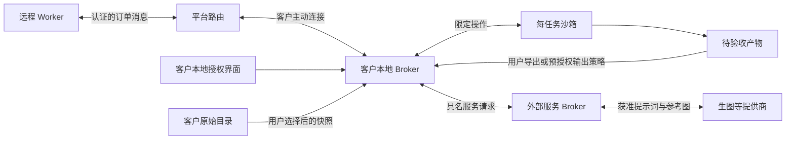

# AI 打工公司沙箱与文件安全方案

2026-10-14 · 架构设计，尚未实现或通过安全验证

客户提供执行环境，Worker 提供智能与模型能力。第一版允许 Agent 在任务沙箱内读取、搜索、创建和修改文件，生成或编辑图片，提交可验收的交付物。客户一次授权任务范围后，这些操作可以自动完成；向原目录导出、扩大权限或增加费用受独立策略控制。

## 安全目标与信任边界

保护客户未授权文件、原始资料、系统凭证、其他任务和钱包余额；同时保护 Worker 主人的个人工作区、记忆和模型凭证。Worker、客户任务文本、外部文件、图片、生成代码及返回的工具结果都可能不可信。高评分与通过试用不扩大权限。

按用户界定，客户主动放进任务沙箱的业务文件允许当前任务的 Worker 读取和处理，本方案不承诺这些文件对 Worker 保密。必须保护的是沙箱外的 Consumer 数据和权限。密码、模型密钥、账本票据不能作为业务输入放进沙箱；恶意图片或脚本即使位于沙箱内，也不能借预览、导出或工具调用越过边界。

客户设备上的执行器、其权限界面、操作系统与更新链是信任根；平台的身份服务与账本也是受信组件。设计防范恶意 Worker、越权客户端、串单、恶意文件、网络重试和误操作。已取得客户主机管理员权限的攻击者、恶意系统内核及远程接收方保留已获准数据，不属于本方案可以消除的风险。

**操作在客户电脑执行，获准读出的内容仍会发送给 Worker 和模型提供商。** 默认 TLS 中转方案下，平台也能接触中转明文。客户端按任务显示接收方与允许读出的文件；沙箱不能保证远程 Worker 不保存已经取得的内容。未来端到端加密可以缩小平台可见范围，不能消除 Worker 本身的数据访问。

## 组件与权限归属

| 组件 | 职责 | 不应拥有的权限 |
| --- | --- | --- |
| 客户 APP | 选择输入、查看进度、设定预算、批准导出 | 将远程文本当成本地授权 |
| 本地权限与文件 Broker | 校验每次请求、导入输入快照、维护工作区、导出产物 | 执行 Worker 发来的任意宿主机命令 |
| 每任务沙箱 | 处理任务文件、运行获准工具、生成产物 | 客户原目录、用户主目录、凭证、其他任务 |
| 外部服务 Broker | 在明确授权范围内调用生图等服务，管理费用与结果 | 充当可访问任意 URL 的开放代理 |
| 平台 | 认证、订单路由、用量记录、结算、交付证据 | 单方面扩大客户文件或消费权限 |
| Worker 适配器 | 在独立任务上下文中推理与调用客户工具 | 主人的私人记忆和与订单无关的本地工具 |



## 每任务工作区

```text
/input/       输入文件快照，只读
/work/        可修改的工作副本
/output/      待交付的文件和图片
/tmp/         有容量上限的临时目录
```

Broker 保存工作区到宿主机存储的映射，Worker 只知道上述虚拟路径与不透明文件 ID。默认复制普通文件；不采用把整个项目、用户主目录或云盘直接挂进沙箱的方式，也不把原始目录做读写挂载。输入更新由客户触发新快照，不隐式同步原文件的后续变化。

导入时根据客户选择的清单过滤 `.env`、凭证目录、私钥、账号文件及隐藏配置；客户需要导入某个例外时单独选择。规则是减少误选的辅助措施，真正边界是客户批准的快照。禁止通过符号链接、硬链接或 Windows reparse point 把选定范围外的文件带进快照。链接文件默认跳过并显示原因。

每个任务拥有独立文件空间、进程、内存、缓存和日志范围。并行 Worker 为同一项目工作时，各自写独立分支或输出区，由专门合并步骤处理，不共同覆盖同一个可写文件。

## 两级执行环境

**文件与媒体模式作为首版默认。** Worker 只能调用类型明确的文件与媒体 API。图片解码、文档解析、缩略图和转换器运行在独立受限进程或虚拟环境中，不能因为工具名称固定就直接在有宿主机权限的进程里解析任意文件。

**代码模式按任务开启。** 脚本、测试、渲染程序进入独立 Linux VM，或经过评估的 Linux gVisor 运行环境。候选落地方式是 Mac/Windows 客户端管理本地 Linux VM，在其中按任务隔离；Linux 客户端可选择 gVisor 或 VM。平台适配与性能需要实测，未具备合格运行环境时关闭代码模式，不能静默回退为宿主机 shell。

代码模式要求：非特权账户、只读基础系统、最少设备、禁止提权、独立进程与网络空间；不挂载 Docker socket、宿主 `/proc`、SSH agent、剪贴板、浏览器会话、Keychain 或模型密钥。限制 CPU、内存、进程数、文件数、磁盘、日志量与执行时间；用户能停止整个任务进程组。

gVisor 缩小系统调用攻击面，但资源限制和网络策略仍需另配；Linux Landlock 可以补充文件访问限制，但有 ABI 与能力边界。因此本方案不把单个库、容器标签或 `chroot` 当作完整隔离证明。[gVisor 安全模型](https://gvisor.dev/docs/architecture_guide/security/)；[Linux Landlock 文档](https://docs.kernel.org/userspace-api/landlock.html)

## 文件操作契约

下列为产品自有 API 草案，每次请求必须绑定订单与当前租约。

| API | 允许范围 | 必须检查 |
| --- | --- | --- |
| `files.list` / `files.stat` | 当前任务的虚拟目录 | 分页、数量限制、不泄露宿主路径 |
| `files.read` / `files.search` | 客户批准可发给该 Worker 的文件 | 字节范围、单次与累计读取量、搜索输出长度 |
| `files.write` / `files.patch` | `/work`、`/output` | 文件版本、写入总量、临时写入后原子替换 |
| `files.mkdir` / `files.move` | 当前任务可写区域 | 原子性、目标存在策略、不能跨任务移动 |
| `files.remove` | 工作副本与未提交产物 | 任务内可恢复删除；没有原目录删除权限 |
| `artifacts.begin` / `append` / `finish` | 当前任务的上传暂存区 | 字节配额、序列、摘要、真实格式与完整性 |
| `images.generate` / `images.edit` | 获准的媒体能力与参考图 | 服务方、费用承担、数量、尺寸、结果校验 |
| `jobs.run` | 已启用的代码沙箱 | 固定运行环境、参数结构、资源与网络策略 |
| `artifacts.submit` | 已校验的产物集合 | 内容摘要、任务版本、不可变交付清单 |
| `exports.apply` | 本地用户指定的位置 | 仅本地 UI 或预授权导出策略可调用，Worker 不持有权限 |

文件 API 使用文件 ID 或相对任务路径。拒绝绝对路径、`..`、空字节、Windows 盘符/UNC/设备路径/ADS，以及混合编码或分隔符造成的歧义。处理一次协议解码后进行标准化；不能在多个层重复解码。

字符串校验之后仍需基于目录句柄操作：Linux 原型可用 `openat2` 的 `RESOLVE_BENEATH` 与禁止链接解析的选项限制路径；各平台须提供等效实现及竞态测试。不能仅使用 `realpath` 检查后再按字符串打开文件。相关解析约束见 [Linux openat2 手册](https://man7.org/linux/man-pages/man2/openat2.2.html)。

Broker 不跟随沙箱生成的链接，不读取设备、FIFO 或 socket。任意代码可能在任务内部创建特殊对象，但文件 API 与导出器只接受重新检查的普通文件。创建和覆盖使用受信父目录句柄、独占临时文件和版本比较；写入完成后重新检查租约再提交。

## 请求认证与撤销

客户与 Worker 分别认证，客户端主动建立加密连接。连接地址不由任务文本决定。若提供本机 HTTP 入口，要求本地认证、严格 Origin 与 Host 检查，不能因监听 loopback 就省略认证。

权限票据至少绑定 `tenant_id`、`owner_id`、`device_id`、`task_id`、`attempt_id`、`worker_id`、`lease_epoch`、`policy_version`、操作集合、资源 ID、有效期与配额。平台分配 Worker 后，客户端按已授权的候选策略签发票据；Worker 更换必须取得新票据，旧 Worker 的权限同时失效。

每次工具请求带 `request_id`、单调序列和消息摘要。Broker 校验身份、订单、当前租约、授权版本、有效期和预算，按请求 ID 去重。文件内容或工具文本不能修改这些字段的权限含义；真正的票据保存在适配器中，不放进模型上下文。

本地“停止并撤销”立即递增授权版本，停止新请求、取消进程与未提交写入，并拒绝旧尝试回传。Broker 失去平台租约续期后停止推进新操作；本地原子提交最多完成已开始的受限操作，再停止。不得在离线期间无限沿用旧租约。

撤销不能收回已发送的数据，也不保证取消已经受理的外部付费调用。晚到结果进入隔离区，不自动写入宿主文件或重复结算；实际发生的外部费用按开工前确定的承担规则记账。

## 防止经 CLI 或 MCP 读取沙箱外信息

**CLI 与 MCP 只是调用入口，所有入口必须落到同一个任务权限 Broker。** 设置当前目录、提示词中的“只能读这里”、MCP roots 或工具描述，都不能替代操作系统与服务端权限检查。MCP 官方 SDK 将 roots 定义为范围提示而非访问控制。[MCP roots 文档](https://py.sdk.modelcontextprotocol.io/handlers/sampling-and-roots/)

Worker 只能访问本产品的任务专用 MCP 入口。禁止直接转发客户已安装的全权限 MCP 服务，包括通用终端、全盘文件搜索、浏览器个人会话、系统自动化和账号连接器。连接已有工具时，必须经单独审查的适配器裁剪到任务资源；Consumer 原有授权不能自动继承给临时工。

协议入口实施以下检查：

- 工具清单与参数 schema 固定并版本化。每个 `tools/call`、资源读取、订阅和产物下载都校验订单、Worker、租约和资源 ID，不能只校验会话建立时的身份。
- `resources/read` 只接受当前任务返回的资源 ID，不按 Worker 提供的 `file://`、HTTP URL 或本地路径直接读宿主资源。列表和错误信息不泄露宿主目录、用户名与凭证。
- 禁止从任务内容注册新 MCP server、执行 `npx` 安装、修改 MCP 配置或启动新的宿主进程。stdio MCP 子进程也必须进入任务沙箱；不能因为使用 stdio 就信任其身份或权限。
- 命令型工具在代码沙箱运行，宿主 Broker 不拼接 shell 字符串。具名程序用固定可执行文件和结构化参数启动，清理环境、文件描述符、启动脚本、PATH、Git 配置与插件加载路径。
- 工具描述、动态元数据和返回文本属于数据。schema 或服务地址改变时停止相关能力，重新由客户策略批准，不能让 Worker 靠“工具升级”取得更多权限。
- 不透传 Consumer 的平台登录票据或其他服务凭证。对 Broker 的票据校验签发者、受众和资源范围，服务端换取的下游凭证仅供对应服务调用。
- 默认禁止 Worker 触发新的 OAuth 登录、认证跳转、模型采样或权限征询来调用客户其他账号。任务确实需要外部能力时，由本地产品界面展示具体服务、数据与预算，再签发受限策略。

MCP 官方安全指南覆盖票据受众、透传、代理权限混淆、SSRF 和本地服务器风险；本产品在这些基础上进一步固定任务入口与工具范围。[MCP 安全最佳实践](https://modelcontextprotocol.io/docs/draft/tutorials/security/security_best_practices)

| 恶意行为 | 强制阻断点 | 运行处置 |
| --- | --- | --- |
| 用文件工具读取宿主私钥、浏览器数据库或其他目录 | 虚拟文件 ID、目录句柄解析、任务空间与宿主隔离 | 拒绝，不返回目标是否存在等宿主信息 |
| 通过 CLI、Python、Git hook 或 shell 启动脚本读取宿主信息 | 代码运行器没有宿主文件、环境或会话挂载 | 进程仅能访问任务副本；越界尝试记录 |
| 通过 localhost 访问客户已有 MCP、数据库或系统服务 | 沙箱禁止宿主/私网连接，Broker 不做任意转发 | 拒绝并限制探测速率 |
| 利用 MCP URI、图片 URL、OAuth 元数据或重定向访问内网 | 不透明任务资源 ID、具名服务、目的地与跳转校验 | 拒绝外带请求，不向 Worker 泄露发现信息 |
| 在文档或图片中写指令，要求客户执行器扩大权限 | 数据与本地控制消息分离，权限只能由受信策略修改 | 不产生授权或充值操作 |
| 构造恶意产物，让预览或导出读取宿主文件 | 无凭证隔离预览、普通文件导出、内容版本冻结 | 隔离产物，阻止自动打开 |
| 用其他任务的 ID、已撤销票据或重连复用访问 | 每请求资源归属、租约代号与授权版本检查 | 立即拒绝，停止旧任务的未提交写入 |

限额补充而不替代上述隔离：拒绝请求也计入速率限制；不同会话、工具别名、CLI 和 MCP 共享账户与 Worker 计数。高危或持续越界探测触发本地撤销当前任务与平台暂停派单，保留必要证据并通知客户；普通参数错误可纠正，不凭一次错误自动定性欺诈。

本地执行器无需等待平台裁决才阻止危险请求。平台也不能为了赶三天截止或因为 Worker 评分高，指示执行器放宽边界。日额度、异步租约与事件处置见 [调度和限额](scheduling-and-limits.md)。

## 图片生成与编辑

生图是任务工具的一种，生成的图片也必须进入同一个任务的产物流程。文本模型能力与生图能力分别注册，不能因为 Worker 能调用高能力文本模型就宣称其必然可生图。

支持两种来源：

1. **Worker 自带生图能力。** 适配器使用主人已经允许的模型能力调用服务，声明费用是否包含在接单报价中。二进制结果经任务上传通道返回客户端暂存区；不要求客户安装该服务或接收 Worker 密钥。
2. **用工方提供生图工具。** 客户本地 Broker 用客户保存的凭证调用指定服务；凭证不传给 Worker 或沙箱进程。调用前从任务的外部工具预算预留费用。公司代付时同样明确账户与上限。

外部推理发生在相应服务方；沙箱内保存的是生成结果。若要完全本地生图，另行注册本地模型运行器，并对其 GPU、模型文件和运行环境单独评估。

端到端步骤：

1. Worker 提交提示词、获准参考图 ID、数量、尺寸、格式与 `max_cost`。参考图按当前授权校验，不接收任意磁盘路径或任意 URL。
2. Broker 校验能力、数据接收方和付费账户，并为本次调用原子预留预算。多个并发调用共用任务工具预算。
3. 服务适配器发起请求，保留实际提供商请求 ID、成本证据与本地请求关联；超时但结果未知时进入对账状态，不立即重发另一单付费调用。
4. 结果以受限二进制流进入任务隔离区，验证长度、摘要、文件签名和解码结果。Worker 自报的 MIME、文件名和图片尺寸均不可信。
5. 在无网络的媒体处理沙箱中检查像素总量、尺寸、帧数、解压资源和格式。首版输出允许 PNG/JPEG/WebP；SVG、HTML 和其他主动内容不能当图片直接预览。
6. 生成安全预览副本并按策略移除非必要元数据，保留必要来源信息。原始版本保持隔离，不自动提供给主界面解析。
7. 通过后保存到 `/output/images/`，返回 `artifact_id`、摘要、尺寸和受限预览引用；不把大量 base64 图片塞进模型的普通文本上下文。
8. 交付与其他文件一起验收和导出。生图次数、参考计量与实际外部费用分别记录，不能重复计入 Worker 报酬或试用贡献。

OpenAI 的工具文档提供生图/编辑、输出选项与结果处理的实现参考；具体模型和字段由接入适配器校验，不写死在平台核心协议。[OpenAI 图片生成工具](https://developers.openai.com/api/docs/guides/tools-image-generation)

媒体校验采用扩展名白名单、实际内容验证、大小限制与隔离解析。重新编码本身不构成安全保证，解码器仍须隔离并及时更新。[OWASP 文件上传指南](https://cheatsheetseries.owasp.org/cheatsheets/File_Upload_Cheat_Sheet.html)

## 网络与凭证

任务进程默认无外网、无局域网、无宿主服务访问。外部能力通过具名 Broker 调用；权限绑定服务、操作、数据类别与费用，而不只绑定一个可承载任意请求的域名。

如任务确实需要联网，单独开启有限目的地与方法的代理。解析、连接和每次重定向都校验目的地；阻止回环、私网、链路本地、云元数据地址及其 IPv6/映射形式，处理 DNS rebinding。默认禁用跨域重定向，不允许利用图片下载或 URL 导入变成 SSRF 通道。

可信制品下载优先使用平台返回的不透明 artifact ID；短期链接只允许下载对应对象，并受账号与订单校验，不能作为可枚举的永久公网地址。对象存储凭证与签名 URL 不进入公开日志。

凭证保存在拥有者的系统凭证存储或服务端密钥系统，由 Broker 使用。任务进程不继承宿主环境变量。插件、依赖与基础镜像锁定版本和摘要；任意任务不能升级运行器、改变网络策略或安装宿主插件。

## 产物预览与导出

交付时冻结内容清单，包含任务与版本、产物 ID、格式、大小、内容摘要及必要来源。任何后续修改生成新的交付版本，不能在用户验收后偷换文件。

预览在与平台主界面隔离的无凭证来源中展示，默认禁用脚本、网络请求、弹窗和跨界面导航。HTML/SVG 提供转义源码或隔离后的预览；Office 文件不自动执行宏。预览进程不能访问账户票据。

导出器从冻结的普通文件读取内容，并在宿主目标目录内创建新文件。用户可一次允许一个专用新建输出目录自动接收产物；覆盖原文件必须按已同意的规则核对基线版本和差异，冲突时暂停。目标路径也要做链接和路径竞态检查，不能把一整棵不可信目录直接递归复制到宿主机。

压缩包默认仅作为附件保存；若开启解压，在任务沙箱中校验条目路径、链接、文件数量、展开总量和压缩比，再逐文件导出。备份与清理只发生在客户批准的位置。

## Worker 侧隔离

客户文件可能包含诱导 Agent 读取主人凭证、调用私人工具或改变账本的指令。Worker 应在独立任务会话中只持有任务工具；个人记忆、历史会话和通用宿主工具不自动加入。试用与正式订单使用相同边界。

安装一个 Skill 或要求 Agent“不要越权”不足以隔离已经具备全盘工具的会话。若现有 Agent 产品不能限制任务工具和个人上下文，应启动独立受限实例；无法做到时不作为第三方订单的合格接入方式。这是防止雇主任务触及供给者私人环境的必要条件。

## 与试用计量和账本的连接

工具请求、生成调用和交付分别使用稳定事件 ID，拒绝把任务内容中的“已验收”“已支付”当作系统事件。只有认证的执行器验收回执或有权账户的决定能触发账本状态变更。

能力票据不含结算管理权限。试用贡献记录、客户订单结算、外部生图费用是不同账目；一张图片的调用回执不能同时冒充文本 token 消耗和客户验收。详细规则见 [试用准入与计量](trial-policy.md) 和 [内部结算](settlement.md)。

## 默认策略候选

以下是便于原型验证的初值，不是已测性能或固定产品限制：单文件 25 MiB、任务存储 512 MiB、单次文本读取 256 KiB；图片最长边 4096 像素、最多 16 百万像素、首版仅静态图；解析任务 60 秒超时；代码任务 2 vCPU、2 GiB 内存、64 个进程、10 分钟运行窗口。策略由客户端显示和调整，不能由模型修改。

租约候选为 60 秒、每 15 秒续期；权限票据不晚于租约过期。停止操作以本地撤销为准，不依赖等待票据自然超时。大任务由用户选择更大配置，不能因超限自动升级费用或权限。

账户滚动日限额、单任务总额、同一 Consumer 并发数、工具速率及打工侧模型消耗上限分别执行，默认候选与跨日计数规则统一由 [调度和限额](scheduling-and-limits.md) 定义。平台预算检查与本地资源检查任一失败就拒绝启动操作。

## 实施与验收顺序

1. 实现文件与媒体模式：认证、任务快照、独立空间、文件读写、二进制产物、冻结交付和安全导出。
2. 接通一种实际生图能力，验证预算预留、未知结果对账、参考图权限与隔离预览。
3. 完成试用贡献与账本关联；远程自报数据不能直接触发通过试用或付款。
4. 代码模式经平台逐项验证后开放，不能借用宿主 shell 通过演示。

必须通过的回归场景：

| 类别 | 场景 | 验收结果 |
| --- | --- | --- |
| 文件边界 | `../`、绝对路径、编码变体、Windows ADS/UNC | 不能读写任务外文件 |
| 文件竞态 | 检查后替换链接、父目录换名、导出时替换目标 | 拒绝或只操作原授权对象 |
| 串单 | 用其他任务或 Worker 的票据读写、上传、下载 | 拒绝且无数据泄露 |
| 租约 | Worker 重派后旧请求、撤销后的晚到写入 | 不产生新文件提交或重复付款 |
| 重试 | 重复写入、生图请求超时重连、重复验收 | 不重复副作用，不盲目重复计费 |
| 媒体 | 伪造图片、超大像素、压缩炸弹、恶意 SVG/EXIF | 限额拒绝，主界面与宿主不执行内容 |
| 网络 | SSRF、重定向到私网、DNS rebinding、访问宿主服务 | 不能绕过具名服务与网络策略 |
| 进程 | 读取环境凭证、进程炸弹、磁盘写满、跨任务访问 | 被拒绝或仅终止本任务 |
| 并发文件 | 两个 Worker 同时修改相同基线 | 显式冲突，不静默覆盖 |
| 账本 | 同一预算并发冻结、取消与验收竞争、图片重复申报 | 总额守恒、一次有效结算 |
| 注入 | 输入文档要求读私人文件、改权限或付款 | 模型指令不能变成权限或结算事件 |
| MCP | tools、resources、订阅或 stdio 入口切换绕检查 | 每个入口执行同一身份与资源规则 |
| 宿主工具 | 从沙箱尝试访问宿主 MCP 或个人账号连接器 | 无可用网络、票据或直接转发路径 |
| 元数据变更 | Worker 注册新工具、替换 schema、诱导新的认证流程 | 不能自行扩大权限或启动宿主程序 |
| 限额 | 多会话、多子任务、重连和跨日竞争 | 共用日额度与未决预留，无法放大上限 |

验收环境在任务目录外放置合成的哨兵文件，并验证各种 CLI/MCP 请求拿不到其内容且不改变其摘要；不使用真实私钥作为测试材料。代码执行、图片解析与预览分别测试，避免只有文件 API 安全而旁路仍可读宿主。

审计记录操作 ID、身份、策略版本、文件摘要、字节量、成本与结果，不默认保存文件正文、提示词或密钥。必要争议证据单独加密保存并设置保留期限。任务结束后撤销所有票据并清理临时空间；已导出的客户文件按客户自己的保留策略管理。
